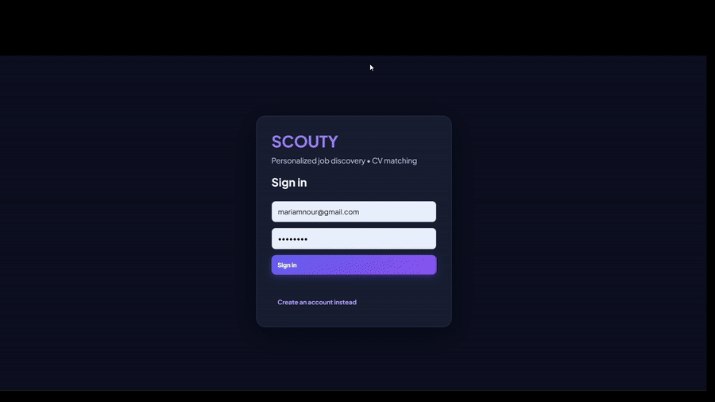
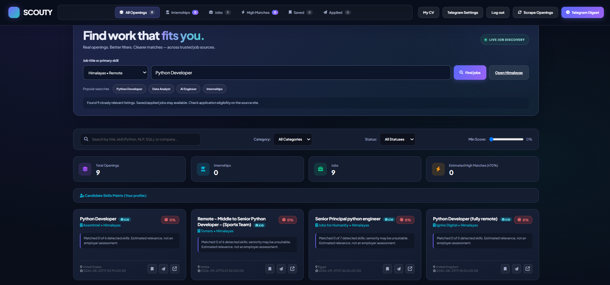
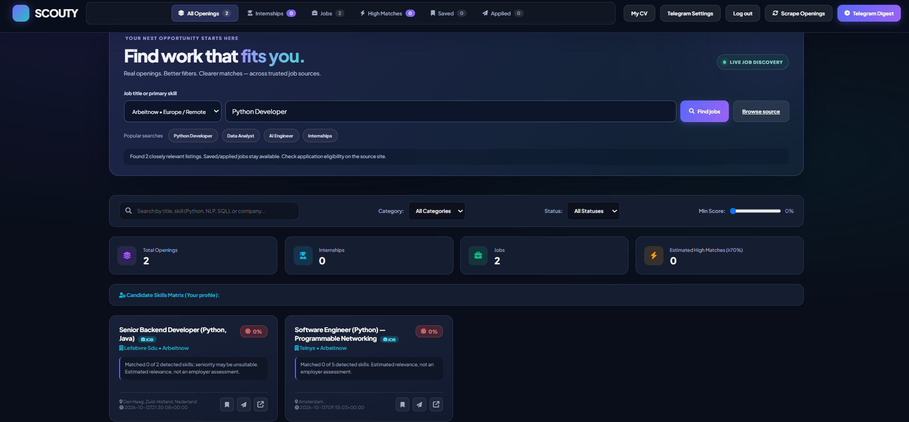
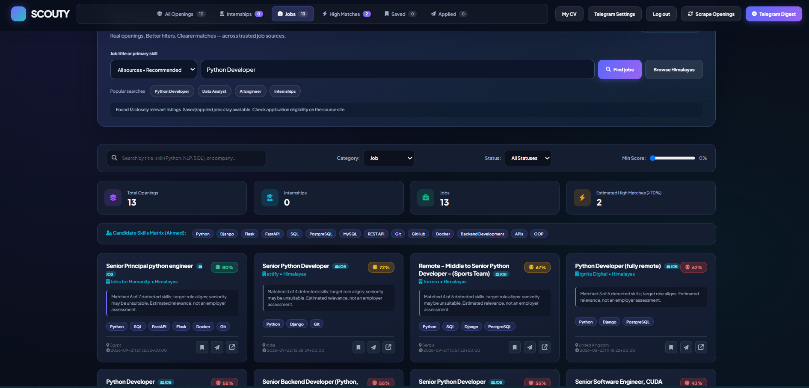
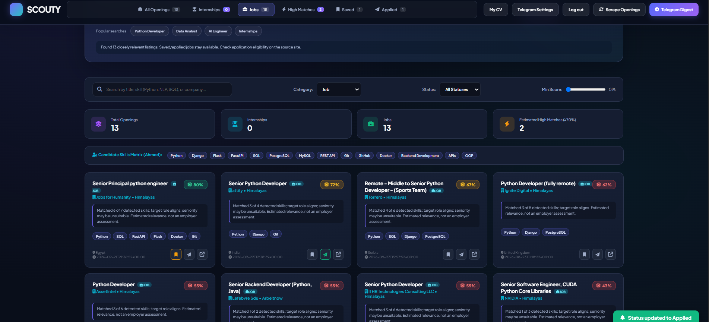

<div align="center">

# SCOUTY AI


## 🚀 Live Demo

Explore SCOUTY AI directly in your browser:

🌐 **[Launch SCOUTY AI](https://scouty-ai-multi-agent-system.vercel.app)**

> Note: 
This project is available as a public portfolio demo on Vercel. It supports local development with SQLite, while the hosted demo uses temporary storage and is not intended for persistent user data.


## 🎥 Project Demo

Watch SCOUTY AI in action:



---

Python · FastAPI · JavaScript · SQLite · Job feed integrations

</div>

---

## Overview

SCOUTY AI is a full-stack job-discovery prototype that brings job search, CV parsing, transparent skill-based matching, and application tracking into one interface. It runs locally and keeps each registered user's CV and job status in a local SQLite database.

This is a **portfolio / development project**, not a production-hosted service. Search availability depends on the public job feeds.

## Preview



<details>
<summary>More screenshots</summary>

**Additional search results**



**CV matching**



**Saved and applied jobs**



</details>

## Key capabilities

- **Multi-source job discovery:** on-demand search across Himalayas, Remotive, Remote OK and Arbeitnow, with original listing links and source attribution.
- **CV management:** create or edit a profile and import text-based PDF, DOCX or TXT resumes.
- **Explainable skill matching:** conservative, skill-based relevance signals instead of misleading hiring probabilities.
- **Job tracking:** save jobs, mark applications, and retain statuses in a personal account.
- **Account separation:** registration, login and HTTP-only sessions for local multi-user use.
- **Responsive front end:** dashboard, search filters and match indicators.
- **Regression tests:** scripts for app routes, matching and job feed behavior, including mocked failure scenarios.

## Tech stack

| Layer | Technologies |
| --- | --- |
| Backend | Python, FastAPI, Uvicorn, Pydantic |
| Frontend | HTML, CSS, vanilla JavaScript |
| Database | SQLite |
| Integrations | HTTPX, Beautiful Soup, public job feeds |
| Document processing | pypdf, python-docx, ReportLab |
| Testing | Python integration and regression scripts |

## Quick start (Windows / VS Code)

Prerequisites: **Python 3.11+**, pip and an internet connection for live job searches.

```powershell
# In the SCOUTY-AI project folder
py -3.11 -m venv .venv
.venv\Scripts\python.exe -m pip install -r requirements.txt
.venv\Scripts\python.exe -m uvicorn app:app --host 127.0.0.1 --port 8050
```

If Python 3.11 is not installed, use another compatible Python 3.11+ version with `python -m venv .venv`.

Open **http://127.0.0.1:8050/** in your browser and create a local test account. Alternatively, use `start.bat` on Windows after dependencies are installed.

Configuration is optional: copy `.env.example` to `.env` and change the host or port for **local use only**. Never commit `.env`.

API documentation is available locally at **http://127.0.0.1:8050/docs**.

## Project structure

```text
SCOUTY-AI/
├── app.py                      # FastAPI routes, auth, data access
├── config.py                   # Local settings and database path
├── graph/state.py              # Typed application state
├── nodes/                      # CV parsing and skill scoring
├── scrapers/live_scraper.py    # Job feed retrieval and relevance logic
├── static/                     # Web interface
├── screenshots/                # UI examples for this README
├── docs/TEST_RESULTS.txt       # Historical test output (offline/mocked)
├── test_*.py                   # Integration/regression tests
├── run_all_tests.py            # Test suite launcher
├── requirements.txt
├── start.bat
├── .env.example
└── .gitignore
```

## Testing

```powershell
.venv\Scripts\python.exe run_all_tests.py
```

The supplied test-evidence log reports **6/6 passing test scripts** for the packaged build. See [`docs/TEST_RESULTS.txt`](docs/TEST_RESULTS.txt). These are **historical results**, not a claim that the tests ran on every machine. External provider calls are mocked in several tests; successful tests **do not guarantee live provider availability**.

## How matching works

SCOUTY extracts available skills from CV text and compares them with job descriptions to produce a transparent relevance score. Scores are heuristic indicators for exploration—not employer assessments, interview probabilities, or guarantees of eligibility.

## Limitations and responsible use

- Public job feeds can change, rate-limit, block requests, or return missing results; always confirm job details at the original URL.
- Scanned/image-only PDFs are **not supported** by OCR in this build.
- Arabic/RTL text in exported PDFs may not render correctly with the current built-in PDF fonts; English exports are the safer option.
- User accounts and resume content are stored locally in `data/`, excluded by `.gitignore`.
- **Not production-ready:** current cookie settings are for localhost. Public deployment requires HTTPS/secure cookies, CSRF defenses, rate limiting, proper input/security reviews, and an operational privacy/backup policy. Do not directly expose this app to the public internet.
- This repository contains source code and sample UI screenshots, **not a live hosted service**.

## Privacy and security

Never commit `.env`, credentials, real CVs, generated databases, or user records. The `.gitignore` excludes common local secrets and databases, but review all files and Git history before publishing. If a credential was previously exposed, **rotate it** even if removed from the newest commit.

## Future improvements

- Expand automated coverage of real provider behavior with controlled network checks.
- Production-grade auth and CSRF protection.
- Full multilingual CV parsing and robust Arabic PDF export.
- Optional deployment pipeline and observability.

---

**Portfolio note:** Source code is shared for demonstration and technical review. No open-source license has been granted in this repository.

## Optional LangGraph agent workflow (additive extension)

This extension adds a **read-only**, three-node LangGraph workflow without changing SCOUTY's original search, login, CV upload, matching, or application tracking behavior.

`cv_agent -> matching_agent -> insight_agent`

- `cv_agent`: extracts a CV profile from text or uses the currently saved profile.
- `matching_agent`: calls SCOUTY's existing explainable matching algorithm to rank submitted job postings.
- `insight_agent`: summarizes high matches and skill gaps.

These are **deterministic tool-based graph nodes**, not LLM-powered autonomous agents. The extension does not currently implement RAG, LLM calls, agent routing, or persistent workflow history. Do not claim those features are present.

### Install and run

```powershell
py -3.11 -m venv .venv
.venv\\Scripts\\python.exe -m pip install -r requirements-agents.txt
.venv\\Scripts\\python.exe -m uvicorn app:app --host 127.0.0.1 --port 8050
```

Visit http://127.0.0.1:8050 and sign in. The original UI continues to work. Interactive API docs: http://127.0.0.1:8050/docs (expand `POST /api/agents/analyze`). The agent endpoint requires an authenticated session cookie. For a sample request, use `jobs` with normal `JobPosting` fields and omit `cv_text` to use your saved profile. When `cv_text` is given, a temporary extracted profile is used; nothing is overwritten in the database. Agent output is returned as JSON, not yet integrated into the main interface.

```powershell
.venv\\Scripts\\python.exe test_smoke.py
.venv\\Scripts\\python.exe test_regression.py
.venv\\Scripts\\python.exe test_agents.py
```

> Note: `langgraph` is intentionally optional. If you install only `requirements.txt`, the existing application still works; only `/api/agents/analyze` returns a descriptive 503 until the optional dependency is installed.


## Optional advanced agent workflow (LangGraph + LLM)

This additive feature preserves **all existing routes and UI**. It exposes a separate authenticated
`POST /api/agents/advanced` endpoint with four specialist stages: **Profile → Matching → Market Insights → Review**.
Matching scores remain deterministic and explainable, while optional LLM calls improve role inference
and produce evidence-based recommendations. The review stage checks ordering and valid scores.

Install: `pip install -r requirements-agents.txt`; launch `uvicorn app:app --reload --port 8050`.
Sign in through the regular UI and open `/docs`. The endpoint accepts `cv_text` and up to 100 `jobs`.
Set `llm_enabled: false` for offline mode (default). For LLM mode, copy `.env.example` to `.env`,
set `SCOUTY_LLM_API_KEY` (and model/endpoint if needed), restart the app, then set `llm_enabled: true`.
**Only explicit requests** send skill/title summaries and job-match summaries to the configured LLM provider;
raw CV text, names, email addresses and phone numbers are not submitted. Use a trusted endpoint.
LLM output is not used to invent jobs or change match scores. On API failure the pipeline falls back safely.
Check `llm_used` in the response; an enabled flag does not prove the model was called successfully.

Test locally: `python test_agentic.py`, `python test_agents.py`, `python test_smoke.py`, `python test_regression.py`.
These scripts don't require an LLM key; `test_agentic.py` mocks its LLM calls.
**Not implemented:** embeddings/vector-search RAG, autonomous tool-calling, or production-grade provider monitoring.
